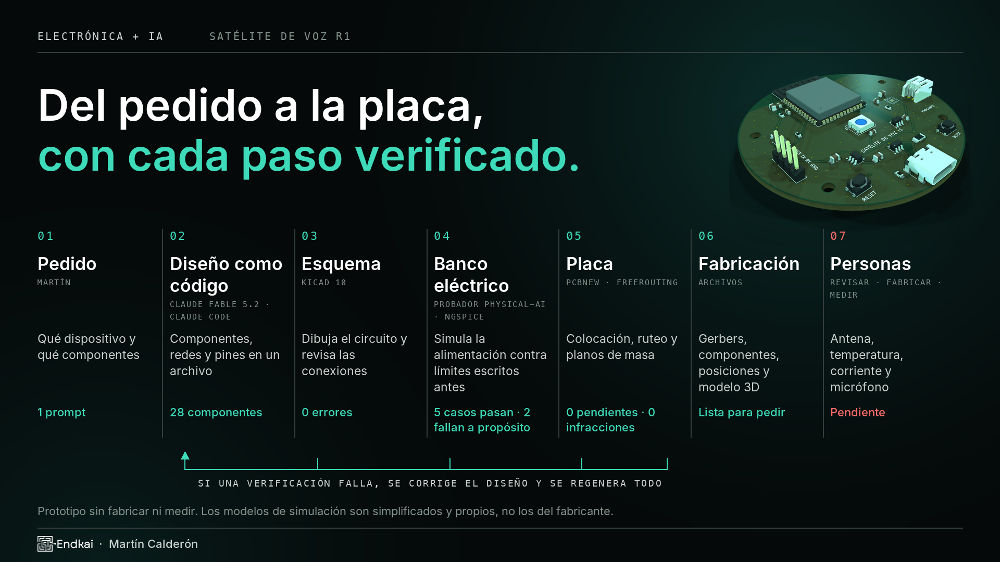
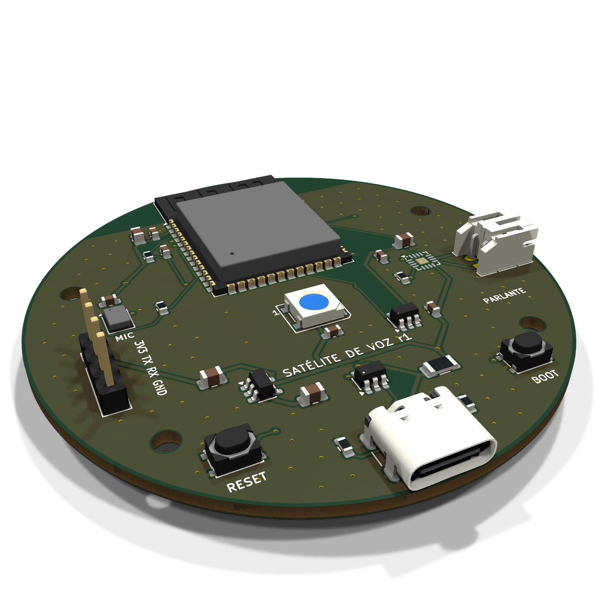

# Satélite de voz r1

Una placa electrónica para un asistente de voz, diseñada con Claude Fable 5.2 a partir de un pedido
corto y verificada en cada paso con herramientas libres.

**Estado: prototipo sin fabricar ni medir.** Las verificaciones de este repositorio comprueban reglas
de dibujo y una simulación con modelos simplificados. No validan el comportamiento eléctrico, térmico,
acústico ni de radio de una placa real.





## Qué es

| | |
|---|---|
| Placa | Redonda, 62 mm, 2 capas, 28 componentes |
| Procesador | ESP32-S3-WROOM-1 (Wi-Fi, USB nativo) |
| Audio | Micrófono digital ICS-43434 y amplificador MAX98357A, cada uno en su bus I2S |
| Estado | LED WS2812B con adaptación de nivel a 5 V |
| Alimentación | USB-C, fusible rearmable de 1 A, regulador AP2112K a 3,3 V |

## Cómo se hizo

1. **Pedido.** Qué dispositivo y qué tipo de componentes: [docs/prompt.md](docs/prompt.md).
2. **Diseño como código.** El modelo escribe componentes, redes y pines en [hardware/design.py](hardware/design.py).
3. **Esquema.** `gen_sch.py` genera el esquemático de KiCad y KiCad revisa las conexiones (ERC).
4. **Banco eléctrico.** `qa/check_power.py` exporta ese mismo esquemático a SPICE y simula la alimentación
   contra límites escritos antes de correr ([hardware/qa/spec.json](hardware/qa/spec.json)).
5. **Placa.** `gen_pcb.py` coloca los componentes, Freerouting traza las pistas y KiCad revisa las reglas (DRC).
6. **Fabricación.** Gerbers, taladros, lista de componentes, posiciones y modelo 3D en [out/fabricacion](out/fabricacion).

Cuando una verificación falla, se corrige el diseño y se regenera todo. Las decisiones y lo que cambió
en el camino están en [docs/DISENO.md](docs/DISENO.md).

## Resultados

| Verificación | Resultado |
|---|---|
| Esquema (ERC) | 0 errores, 1 aviso de biblioteca |
| Placa (DRC) | 0 infracciones, 0 conexiones pendientes, coincide con el esquema |
| Banco eléctrico | 5 casos pasan; 2 casos defectuosos fallan como deben |

El banco encontró dos cosas para atender antes de fabricar ([informe completo](docs/banco-electrico-report.json)):

- Con parlante de 8 Ω a potencia máxima y Wi-Fi transmitiendo, el consumo medio es 0,62 A: más que los
  0,5 A de un puerto USB 2.0. Hace falta una fuente de 1 A o limitar el volumen en el firmware.
- El regulador disipa 0,56 W durante cada ráfaga de Wi-Fi. Con transmisión sostenida hay que medir su temperatura.

## Abrir y regenerar

Abrir `hardware/satelite_voz.kicad_pro` con KiCad 10.

```bash
hardware/build.sh
```

```bash
python3 hardware/export.py fabrication
```

Requisitos y límites de esta versión:

- macOS con KiCad 10 en `/Applications` (las tablas de bibliotecas usan esa ruta).
- `hardware/route.py` busca Freerouting 2.5.0 y su Java en `~/repos/physical-ai/tools/freerouting`.
- `hardware/qa/check_power.py` usa ngspice 47 y las utilidades `spice_lab.py` de un laboratorio propio
  que todavía no es público; sin ellas, el banco no corre.
- Los modelos de `hardware/qa/models` son equivalentes propios y simplificados, no los del fabricante.

## Antes de fabricar

La lista completa está en [docs/DISENO.md](docs/DISENO.md). Lo principal: revisión humana contra las hojas
de datos, alcance de la antena, temperatura del regulador, corriente por USB y el agujero acústico del micrófono.

## Licencia

El diseño de la placa, los archivos de fabricación y los scripts se publican bajo
[CERN-OHL-P v2](LICENSE) (hardware abierto, permisiva). Puedes usarla, modificarla y fabricarla
citando el origen. Se entrega tal cual, sin garantías: es un prototipo que nadie fabricó ni midió.

Fuente: https://github.com/MartinCalderon-x/alexa-con-fable
